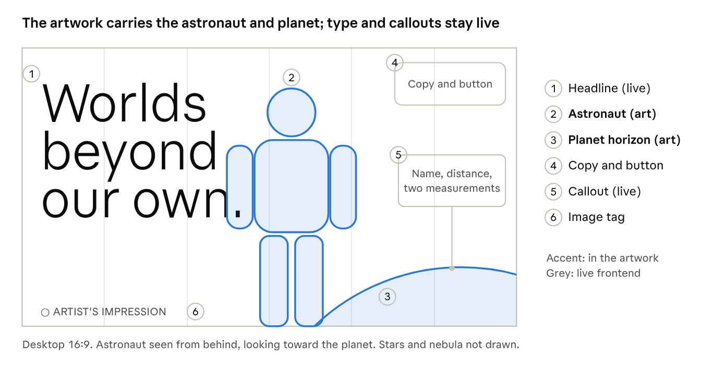

# Exoverse — Homepage Visual Breakdown v0.2

The homepage should feel like walking into an observatory's private archive: cinematic in the first second, rigorous on a closer look. This breakdown fixes the structure, type, imagery and motion before any code, so you can approve or redirect it.

**v0.2 update (24 November 2026).** Hero decision V1 is settled: the hero is a custom 3D composition, rendered offline from properly licensed assets and delivered as optimized layered images, with an optional short loop later. The astronaut is seen from behind or in three-quarter view, looking toward a dramatic planet horizon. Headline, navigation, buttons and annotations stay live frontend elements, never part of the artwork. The six-section structure, type system, palette and all other decisions are unchanged. What changed: a new "Hero artwork" passage in section 3, the hero layers and placement in 5.1 (and the wireframe), the hero rows in section 7, one performance rule in section 9, and V1 plus the open questions in section 10. Revised after review the same day: the palette is now the same token set as the Visual Guide (ember removed), Featured Worlds and the pull-back no longer centre on one planet, and the navigation shows only features that exist (section 4).

## 1. Design intent

All four screenshots are used (you mentioned two; four came through). Each contributes one idea and leaves the rest.

| Reference | What we take | What we leave |
| --- | --- | --- |
| inOrbit | Oversized light headline fading from white to pale blue; astronaut overlapping the headline for depth; hairline vertical grid; data callouts with leader lines on a planet | Circular "Explore" button, booking-style outlined CTA, pill navigation |
| NOVA | Restrained glass cards, thin icons, small status labels; one muted accent colour carrying hierarchy | Dashboard framing (fleet, mission counts, timeline). Exoverse teaches; it is not a control panel |
| Astronyx | Planets floating around the figure at different sizes and depths; text blocks in opposite corners; a leader line to a detail crop | Faceted crop shape, saturated planet colours, event and booking details |
| Galactic | One large planet limb rising from the bottom edge; light-weight title; a single call to action | Centred symmetry and the blue glow around the page frame |

What makes Exoverse its own, in four moves:

1. **The plate.** Every page is composed like a plate in a printed observatory atlas: faint 12-column hairlines, coordinate ticks on the margins, small catalogue-style annotations beside the imagery.
2. **Provenance on every image.** A small tag says whether a picture is an observation, a scientific visualization or an artist's impression. Honesty becomes part of the look.
3. **Editorial type.** A light grotesk at very large sizes, with one serif-italic word per headline for emphasis.
4. **One cold accent.** Navy and black dominate; ice blue marks what is interactive, selected or measured, with violet and amber in small supporting roles. No warm decorative accent is approved.

## 2. Visual identity

The palette is almost entirely navy and black, with one ice-blue accent doing most of the signalling and violet and amber in small supporting roles. Hex values are starting points; contrast (target 4.5:1 for text) is checked on the first build.

| Token | Value | Use |
| --- | --- | --- |
| void | #050812 | Page background, hero base |
| abyss | #070B16 | Alternate section background |
| surface | #0D1422 | Cards, panels, image frames |
| surface-raised | #111C2D | Hover, modal, menus |
| starlight | #F4F7FB | Headlines, primary text |
| mist | #A7B4C7 | Body and secondary text |
| dim | #718096 | Captions and annotations (not body copy) |
| hairline | rgba(160,190,220,0.16) | Borders, rules, grid lines (grid lines drawn fainter, about 6%, on the hero and premise) |
| ice (primary accent) | #70D6E8 | Links, focus ring, selected states, key measured values, headline fade end, planet rim light |
| violet (secondary accent) | #9B8CFF | Secondary emphasis only, such as a comparison series; never a large fill |
| evidence green | restrained green, value fixed in the first token file | Observed and Established status only |
| amber | restrained amber, value fixed in the first token file | Caution notes and Hypothesis or Speculative labels only |

**One token system.** This table is identical to the Visual Requirements Guide v2.0, section 3, and applies to Home, Explore, Topic pages, Experiences, Labs and the assistant. Pages differ in how much cinematic imagery they use, not in colour. Ice is the only accent used for interaction. Violet and amber are used sparingly and never as decoration, and neither green nor amber carries meaning without text and an icon. The v0.1 tokens limb blue, navy and ember are retired: limb blue becomes ice, navy becomes surface, and the ember accent is not approved (decision V5). Values are starting points; contrast is checked on the first build.

**Type.** Three families, all open-licensed, self-hosted.

| Role | Family and weight | Size (desktop, fluid) | Notes |
| --- | --- | --- | --- |
| Hero display | Inter, 300 | 56 to 160 px, line height 0.92 | Tracking -0.045em; fades white to ice; one word in serif italic |
| Section display | Inter, 300 | 36 to 88 px, line height 1.0 | Same fade, shorter lines |
| Card title | Inter, 400 | 24 to 32 px | Never fades |
| Body | Inter, 400 | 17 to 18 px, line height 1.6 | Maximum 60 characters per line |
| Emphasis word | Instrument Serif, italic | Matches the headline | One per headline, never in body |
| Annotation | IBM Plex Mono, 400 | 11 to 12 px, uppercase | Tracking +0.08em; coordinates, provenance, units, credits |

**Grid and annotation language.** Twelve columns, 64 px outer margin on desktop. Hairlines sit on column edges at about 6% opacity, only on the hero and the premise section. Coordinate ticks run along the top and left margins, decorative and hidden from screen readers. Leader lines are 1 px, end in a small dot, and always point at something real in the image. An annotation that points at nothing is removed.

**Glow and motion budget.**

- One glow only: the atmospheric edge of a planet. Borders stay 1 px hairlines, with no glowing outlines.
- Backdrop blur only on the navigation bar.
- At most two elements animate at the same time in any viewport.
- Durations 600 to 900 ms, ease-out. Nothing loops except the hero's slow drift (under 12 px of travel).
- Amber and violet are never decorative: amber only for caution and Hypothesis or Speculative labels, violet only for secondary emphasis.

## 3. Imagery system

Every image on the site belongs to exactly one of three classes and carries a tag that says so. The tag is shape plus words, never colour alone.

| Class | Tag | What it means | Typical sources |
| --- | --- | --- | --- |
| Observed | ● OBSERVED | Light actually recorded by a telescope, spacecraft or astronaut. Colour processing allowed, stated in the caption | NASA photograph, Hubble, JWST, rover and orbiter images |
| Scientific visualization | ◐ VISUALIZATION | Built from real data: a map, a model, a plotted orbit, an enhanced-colour composite of measurements | NASA Scientific Visualization Studio, our own 3D scenes driven by catalogue values |
| Artist's impression | ○ ARTIST'S IMPRESSION | Imagined from limited data, or any composite that includes imagined elements. Drawn with a dashed outline | Exoplanet concepts, the hero composition |

**Rules.**

- A composite takes the class of its least observational part. The hero is therefore an artist's impression, even though the astronaut is a photograph.
- The tag is always visible on desktop and touch, bottom-left of the image, in the annotation style. It is never hover-only.
- Selecting the tag opens a small panel: a one-sentence explanation of the class, the credit, the source link and the licence.
- The tag, credit and licence come from the reviewer-recorded image kind, credit and licence on each media asset in the blueprint. The frontend never decides the class.
- A planet with no real image (every exoplanet) is only ever shown as an artist's impression, and the page says so near the image.
**Hero astronaut: three ways to source it.** This is the single most important asset on the site. Decided on 24 November 2026 (V1): option B, extended to a full custom composition; see "Hero artwork" below.

| Option | What it is | For | Against |
| --- | --- | --- | --- |
| A. NASA EVA photograph, background removed | A real spacewalk photograph, cut out and colour-graded to the navy palette | Authentic, free, strongest cinematic realism; credit NASA | Careful masking of the visor reflection and suit edges; needs a very high-resolution original (at least 3,000 px tall) |
| B. Rendered 3D astronaut | An openly licensed model rendered in Blender into layered PNGs | Full control of light and pose; clean edges | Looks less real; modelling and lighting effort; licence must be checked |
| C. Live 3D astronaut in the browser | The model running in React Three Fiber in the hero | Moves with the cursor | Heavy download, risks the first-load score, blocks the learning order (3D arrives in M6) |

Recommendation: Superseded by decision V1 (24 November 2026): a custom 3D composition (option B, extended to a full scene) rendered offline from properly licensed assets, with a NASA photograph cutout (option A) as the fallback if the render does not reach the quality bar. C is deferred; the hero stays a layered image so the homepage loads without WebGL.

NASA's media guidelines say its imagery is generally not copyrighted, that the agency insignia is protected, and that credit should be given. Each chosen photograph still gets its own licence check before it enters the media table.

**Planets in the hero.** One dominant planet horizon, rendered as an artist's impression of an exoplanet that matches a published topic (which world is open question HB-Q4; TRAPPIST-1e, the first vertical slice, is one candidate, not the identity of the site), plus up to two small distant bodies kept as separate images, for example Mars or Jupiter from spacecraft imagery, tagged observed. Each has its own small tag when selected. The horizon planet is the hero's one large body; floating planets stay secondary.

**Hero artwork: the decided direction (V1, 24 November 2026).** The hero is one custom 3D composition, rendered offline from properly licensed 3D assets and shipped as optimized images. No real-time 3D runs on the homepage.

**Composition (desktop, 16:9).**

- The astronaut is large and central, about 78 vh tall and slightly right of centre, seen from behind or in three-quarter view and looking out into space. A back or three-quarter view also avoids a visor reflection, the hardest thing to render convincingly.
- A dramatic planet or planetary horizon fills the lower right, with a thin cold atmospheric rim. It is the scene's one large body.
- Surroundings are deep navy to near black, with restrained ice-blue rim light on the suit and the planet's limb. No warm accent in the hero, so decision V5 does not affect it.
- Generous negative space on the left and top for the headline and copy; the upper right stays quiet for the annotations.
- The artwork contains no text, logos, flags or mission patches.

**What is artwork and what is frontend.**

| Element | Where it lives | Why |
| --- | --- | --- |
| Astronaut | Rendered, delivered as its own transparent image layer | Lets the headline sit behind it and allows pointer parallax |
| Planet horizon, stars, nebula wash | Rendered, delivered as one background plate | Depth and lighting a browser would struggle to match |
| Headline, supporting copy, buttons, navigation | Frontend text and components | Crisp at every size, selectable, accessible |
| Annotations, leader lines, planet callouts | Frontend SVG and text, placed from stored anchor points | Values come from topic records and stay correct; lines always meet the planet |
| Vertical grid lines, scroll cue, counters, image tag | Frontend (CSS and SVG) | Part of the interface, not the picture |
| Soft limb glow into the next section | Frontend gradient (L6) | Blends the hero into section 02 at any height |

**Delivery.**

- Desktop master rendered at 3840 by 2160 px, with the plate and the astronaut layer exported separately and delivered at about 1280, 1920 and 2560 px wide, as AVIF with a WebP fallback.
- Mobile uses its own portrait render (proposed 1290 by 1935 px, delivered at about 640, 960 and 1290 px), not a crop of the desktop image: astronaut centred, horizon along the bottom. Tablet uses a 4:3 crop of the desktop master.
- Each export has a small anchor file giving the planet limb points and leader-line end points as percentages of the frame, so annotations land correctly at any size.
- Proposed weight budget, to be measured in M7: the two desktop layers together under about 450 KB at 1920 px, and the mobile pair under about 200 KB.
- The blurred placeholder and the astronaut layer are preloaded. The plate is the largest contentful paint element, so it is optimized first.

**Static first, loop second.**

- The static layered hero is the real hero. It is what slow connections, reduced-motion visitors, Save-Data users and visitors without JavaScript see.
- An optional loop may be added later: a seamless 5 to 8 second muted clip of the background plate only (star twinkle, slow nebula drift, faint limb shimmer), in WebM with an MP4 fallback, desktop only, about 1.5 MB at most. The astronaut keeps its own CSS drift and pointer parallax instead of being baked into the video, so it stays sharp and transparent.
- The video starts loading only after first paint, only when the visitor has not asked for reduced motion or data saving, and only while the tab is visible. The static plate is its poster frame, so nothing jumps when it starts. If it fails to load, nothing changes on screen.
- A visible "Pause motion" control stops the loop and the drift, because automatically starting motion that lasts more than five seconds needs a way to pause it (WCAG 2.2, success criterion 2.2.2). The choice is remembered.
- Reduced motion means static layers with no drift, no parallax, no loop, and the load sequence replaced by one 200 ms fade. Text sits on a soft scrim wherever the artwork could push contrast below 4.5:1.

**Licensing the 3D assets.**

- Every model, texture, HDRI or planet map is recorded before use: source, licence, credit text, retrieval date and file checksum.
- Accepted: CC0, CC BY (credited on the sources page), or a paid licence that clearly permits use in rendered images on a public commercial website. Rejected: non-commercial, no-derivatives and editorial-only licences.
- The suit is a generic spacesuit with no agency insignia, mission patch, flag or real person's likeness. NASA's insignia are protected, so none appear.
- The finished hero is tagged ○ ARTIST'S IMPRESSION, with the credit line "Scene rendered for Exoverse from licensed 3D assets" linking to the credits page.

**Production process, with review gates.**

1. **Blockout:** a low-quality render of the composition (pose, planet, framing, room for type), checked against the wireframe in section 5.1. Your approval is needed before any high-quality rendering.
2. **Lighting and grade:** final lighting, rim light and colour grade to the palette, checked at mobile and desktop crops.
3. **Export and performance check:** layers, anchor files and weights measured against the budget, plus a contrast check of the type over the artwork.
Source scenes and masters stay in private storage with a checksum list, not in the website repository.

**Risk and fallback.** A custom render is real art production and can grow. Until the artwork is approved, the M4 hero skeleton uses a placeholder gradient plate and a grey astronaut silhouette. A time-box is agreed at blockout approval; if the render does not reach the quality bar within it, option A (a NASA photograph cutout) is the fallback.

## 4. Homepage section hierarchy

The page moves through emotion, trust, proof, wonder, depth and action in six sections, about nine and a half screens of scrolling on desktop, three of them the pinned pull-back. Search stays one click away in the navigation throughout, so the index at the bottom is a destination, not the only way in.

| # | Section | Job | Height | Primary visual | Information density |
| --- | --- | --- | --- | --- | --- |
| — | Navigation | Orient; open search | Fixed, 72 px | None | Minimal |
| 01 | Threshold (hero) | Create the feeling; state the promise | 100 vh | Astronaut with floating planets | Low |
| 02 | Premise | Say what Exoverse is and why it can be trusted | About 100 vh | Oversized statement | Low |
| 03 | Featured worlds | Prove the depth with three topic plates | About 180 vh | One plate per image class | Medium |
| 04 | Pull-back | Make scale felt: Earth outward to a distant system | 300 vh, pinned | Crossfading layered imagery with a distance counter | Medium |
| 05 | Experiences | Preview the interactive 3D | About 100 vh | Poster frame of a 3D scene | Low |
| 06 | The index | Start exploring: search and categories | About 100 vh | Typographic index with hover image | Medium |
| — | Closing band and footer | How to read our images; sources; credits | About 70 vh | Cropped oversized wordmark | Medium |

Why this order: the hero sells the feeling, the premise earns trust before any claim is made, the plates prove there is real content behind the picture, the pull-back is the one long cinematic moment, experiences show what only a browser can do, and the index turns interest into a first click.

**Navigation by release.** The top navigation lists only destinations that exist and have content. Release 1 (M8): wordmark, Explore, Experiences and search. My Universe and account controls appear when accounts launch (M9). Labs appears when the first Lab is published (M12) and lists only published Labs. Ask appears only when the global Ask page launches (M17); until then the assistant exists only as an "Ask about this topic" control on topic pages (from M11). There are no "coming soon" links, empty pages or disabled items. The links are driven by release flags read from the API, so the homepage never needs rewriting when a feature arrives.

## 5. Section-by-section breakdown

Desktop is described first (1440 by 900 design size); section 7 covers other sizes. Copy is draft wording to show the tone and length, not final text.

### 5.1 Threshold (hero), 100 vh

**Purpose.** Create the feeling in one frame and state the promise. A visitor should know within two seconds that this is a space experience with real science behind it.

**Layers, back to front.**

| Layer | Content | Notes |
| --- | --- | --- |
| L0 | Void gradient with a faint star field | Static image, or part of the rendered background plate (see Hero artwork in section 3) |
| L1 | Distant nebula wash in deep navy | Very low contrast; stays behind all text |
| L2 | Planet horizon and up to two small floating planets | The large planet horizon is part of the rendered plate (an artist's impression of the hero exoplanet, HB-Q4). The optional small bodies are separate images, 60 to 140 px, each tagged |
| L3 | Headline "Worlds beyond our own." | Sits behind the astronaut; three lines, "beyond" in serif italic with the white-to-limb-blue fade |
| L4 | Astronaut (rendered layer) | About 78 vh tall, slightly right of centre, seen from behind or three-quarter and looking toward the planet; its own transparent layer; the helmet may overlap the last letters of one headline line, never more |
| L5 | Foreground annotations, copy, call to action, navigation | Hairlines, leader lines, mono labels |
| L6 | Planet limb glow along the bottom edge | The page's only glow; dissolves into section 02 |

**Placement.**

- Headline: columns 1 to 7, top at about 22 vh.
- Supporting copy, top right (columns 9 to 12): about 25 words, for example "A cinematic atlas of planets, stars and the missions that reached them. Every number traceable to its source." Then one filled button, "Start exploring", to the Explore page, and a quieter secondary link, "Explore the unknown", that scrolls to the Premise section. The "How we label images" link sits in the Premise section, not in the hero.
- Planet callout, right of the astronaut: leader lines from the planet's limb to a small annotation stack with the world's name, its distance and up to two more measurements (for example radius and equilibrium temperature), each with its value-kind marker, plus the image tag. Every value is read from that topic's measurements, not from the component, so it can never disagree with the topic page. Selecting the stack opens the topic.
- Bottom left: the hero's image tag, ○ ARTIST'S IMPRESSION, with a one-line credit for the composite.
- Bottom centre: a thin vertical line with a small dot and the mono label "SCROLL", plus the section counter "01 / 06". No circular button.

**Interactions.**

- Load (under 2 seconds, skipped for reduced motion): stars fade in, planets drift in from 24 px away with 120 ms staggers, headline lines reveal upward, the astronaut fades in with a 3% settle, leader lines draw last.
- Pointer (desktop only): layers shift opposite to the cursor, astronaut up to 6 px and planets 12 to 24 px by depth; the headline stays still.
- Scroll: the headline travels slower than the planets, the astronaut rises slightly, and the limb glow brightens into section 02.
- Hover or focus on a planet: its leader line and tag appear; the planet has a visible focus ring for keyboard users.

> **Figure (from source DOCX).** hero wireframe · 6 annotated parts, desktop

> *This figure is stored as `docs/media/Exoverse---Homepage-Visual-Breakdown-v02.png`.*

hero wireframe · 6 annotated parts, desktop

The astronaut (strong outline) overlaps only the last letters of the headline's third line; every other element keeps clear of it.

### 5.2 Premise, about 100 vh

**Purpose.** Earn trust before making any claim: say what Exoverse is and how it treats facts.

- **Layout.** Asymmetric. A statement spans columns 2 to 10, starting at about 18 vh. A mono label "01 — PREMISE" sits in the left margin. At the bottom right (columns 10 to 12) a small catalogue summary: topics, measurements and sources, counted from our own database, not from the providers.
- **Draft statement (about 40 words).** "Exoverse is an atlas of worlds beyond our own. Every planet, star and mission page pairs real imagery with measured values, each traced to the paper or archive it came from, and each image labelled for what it truly is."
- **Type.** Section display, light weight, with one serif-italic word ("truly"). The counts use the ice accent.
- **Imagery.** None in the foreground. The hero's limb glow fades out into abyss, with hairline grid and ticks still faintly visible.
- **Interaction.** As the section crosses the viewport, the statement brightens line by line from dim to starlight. Static under reduced motion. An inline link "How we label images" jumps to the closing band.

### 5.3 Featured worlds, about 180 vh

**Purpose.** Prove there is real content behind the picture with three topic plates, one per image class.

- **Layout.** Three plates staggered on the grid so the eye zigzags down the page: plate A columns 1 to 7; plate B columns 9 to 12, starting about 20 vh lower; plate C columns 4 to 10, lower again. Each plate is an image in a 1 px hairline frame (square corners, unlike the rounded frames in the references) with the image tag bottom-left.
- **Under each image.** Index number in mono, card title (32 px), one line of description, one key measurement with its "N measurements" link (the same summary the topic page's measurements panel uses), and an "Open world" link.
- **Illustrative choice, final picks from the ten M4 topics.** A: an exoplanet, ○ artist's impression (TRAPPIST-1e is one candidate among several). B: Mars, ● observed (orbiter or rover image). C: a black hole, ◐ visualization (for example a NASA simulation of an accretion disk); a galaxy, ● observed, is the alternative. The three plates deliberately span different categories so no single world defines Exoverse, and the first ten topics (M4) should include one object from each.
- **Interaction.** Each plate reveals with a 700 ms upward mask wipe while the image settles from 104% to 100%. Hover or focus brightens the image by about 6%, underlines the title and draws a short leader line to the measurement. The whole plate is one focusable link.
- **Data.** Topics need a featured flag and order so the plates are curated, not hard-coded (see blueprint impacts).

### 5.4 Pull-back, 300 vh pinned

**Purpose.** The one long cinematic moment: make scale felt by pulling back from Earth to a distant system, while teaching how far each step is.

- **Structure.** One pinned viewport, 300 vh of scroll, four stages that crossfade with a slow 4% scale push.

| Stage | Image | Class | Caption idea |
| --- | --- | --- | --- |
| 1 Earth | Photograph of Earth from orbit | ● OBSERVED | Where every measurement on this site begins |
| 2 Solar System | Orbits drawn from real planetary data | ◐ VISUALIZATION | Eight planets, one star, distances compressed |
| 3 Nearest stars | Star field around the Sun | ○ ARTIST'S IMPRESSION | Our neighbours, placed for clarity |
| 4 A distant system | An exoplanet system with one world in focus (chosen from the catalogue) | ○ ARTIST'S IMPRESSION | Other stars have worlds of their own; none can be photographed up close |

- **Layout.** Full-bleed image. Caption and one sentence bottom-left (columns 1 to 4). A large mono distance counter bottom-right (48 px) that changes units as you scroll: kilometres, astronomical units, light-years. A thin vertical log-scale ruler on the right edge with four ticks marks progress.
- **Distances** come from topic records where a topic exists, otherwise from a reviewed constant, never typed freehand.
- **Interaction.** Scroll scrubs the sequence (GSAP ScrollTrigger pin and scrub). At the end, a single link: "Explore this system".
- **Build.** Pre-rendered AVIF and WebP layers, no WebGL on the homepage, so first load stays light.
- **Reduced motion and small screens.** Reduced motion turns it into four stacked static panels with no pin. Mobile keeps the pin but at 200 vh with less parallax.

### 5.5 Experiences, about 100 vh

**Purpose.** Show what only a browser can do, without paying for it on first load.

- **Layout.** Left (columns 1 to 5): the section title with one italic word and two lines of copy. Right (columns 6 to 12): a 16:9 poster frame in a hairline frame, tagged ◐ VISUALIZATION. Beneath, a plain text list of two or three experiences with a mono number and one line each. Names are illustrative until the Experiences page scope from the SRS and the M6 plan is final.
- **Interaction.** The poster is a still. A single "Enter" control loads the 3D scene on request: a dynamically imported React Three Fiber chunk, then drag to rotate. It never autoplays.
- **Fallbacks.** The poster stays, with a link to the topic page, when WebGL is unavailable, when the browser asks to save data, or on low-power devices.
- **Honesty.** Orbits and sizes are drawn from catalogue values. When distances or sizes are not to scale, a caption says so in the scene.

### 5.6 The index, about 100 vh

**Purpose.** Turn interest into a first click. This is a destination for search and browsing, not a dashboard.

- **Layout.** Top: an oversized search field (section display size) with the placeholder "Search a world, a star, a mission" and a "⌘K" hint. Under it, a row of mono suggestions as plain text links. Below: the category index as full-width typographic rows separated by hairlines. Each row: mono number, category name at about 56 px, live topic count, arrow. Categories come from the topic types in the schema.
- **Interaction.** Search opens the same overlay as the navigation search. On desktop, hovering a row shows a floating preview card (about 280 by 360 px) that follows the cursor, carrying its image tag. Keyboard: arrow keys move between rows and focus shows the preview.
- **Touch.** No hover preview. Each row shows a 64 px thumbnail at the right and taps straight through.

### 5.7 Closing band and footer, about 70 vh

**Purpose.** Close with the site's promise about honesty, then the practical credits.

- **How to read what you see.** Left: a headline. Right: three columns, one per image class, each with its tag symbol and one plain sentence. This reuses the same tag component as every image.
- **Sources strip.** Provider names as text only, with no logos: for the MVP, the NASA Exoplanet Archive and the NASA Image and Video Library. The list is generated from the provider table so it cannot drift from what was actually imported.
- **Footer.** Links to Explore, Experiences, About, Sources and credits, and the GitHub repository. A line stating Exoverse is independent and not endorsed by NASA or any agency.
- **Closing flourish.** The wordmark "Exoverse" at about 22 vw, cropped by the bottom edge, in abyss on void so it is a texture, not a logo bar.

## 6. Interaction and scroll choreography

Motion carries the cinematic feel, but only the pull-back takes control of scrolling. Everything else reacts to scroll without holding the page.

| Moment | What happens | Duration | With reduced motion |
| --- | --- | --- | --- |
| Hero load | Layered reveal: stars, planets, headline, astronaut, leader lines | Under 2 s | Everything visible at once |
| Pointer parallax | Layers shift 6 to 24 px opposite the cursor, desktop only | Continuous | Off |
| Scroll reveals | Upward mask wipe on plates and headlines | 700 ms | Plain fade, 200 ms |
| Pull-back | Pinned, scrubbed crossfade through four stages | Tied to scroll | Four stacked static panels |
| Route change | Plate image grows into the topic page's opening image (View Transitions API where supported) | About 500 ms | Instant |
| Hover and focus | Brightness, underline, leader line | 200 ms | Colour change only, no movement |
| Smooth scrolling | Eased wheel scrolling on desktop | Continuous | Native scrolling |

**Rules.**

- Animate only transform and opacity.
- The native scrollbar stays visible. Keyboard scrolling, anchor links and browser find keep working.
- Smooth wheel scrolling uses a small library (Lenis is the usual choice, to be checked when installed) and is off for touch and for reduced motion.
- The pull-back has a "Skip" link before it for keyboard and screen-reader users.
- Drift and parallax pause when the tab is hidden or the section is off screen.

## 7. Responsive behaviour

Three layouts: desktop from 1280 px, tablet 768 to 1279 px, mobile under 768 px. The hero uses 100 svh so mobile browser bars do not clip it.

| Section | Tablet | Mobile |
| --- | --- | --- |
| Hero | Same composition, cropped to 4:3 from the desktop master; one or two small planets; headline overlap kept | Headline first at about 56 px, astronaut and planet horizon from a separate portrait render (not a crop), astronaut centred at about 60 svh below it, supporting copy and button under the astronaut; no floating planets; callout becomes a tag line beneath; no pointer parallax; hairlines drop to four columns |
| Premise | Statement columns 1 to 11 | Full width; counts stack |
| Featured worlds | Two-column stagger | Single column, plates full width |
| Pull-back | 300 vh | 200 vh, less parallax; ruler moves to a thin top bar |
| Experiences | Poster above text | Poster above text; "Enter" button full width |
| Index | Rows with thumbnails | Rows with thumbnails, 44 px minimum touch height |
| Footer | Three columns | One column; wordmark still cropped |

**Images.** Every image ships at several widths (about 640, 1280, 1920 and 2560 px) in AVIF with a WebP fallback, with sizes set so a phone never downloads a desktop file. The hero's first paint uses a small blurred placeholder; the astronaut cutout is preloaded.

**Hero art direction.** The hero uses art-directed sources: a 16:9 pair (plate and astronaut layer) on desktop, a 4:3 crop on tablet and a portrait pair on mobile, each with its own anchor file for the annotation lines. The optional loop is desktop only. Reduced-motion and Save-Data visitors always get the static pair.

## 8. Consistency across Home, Explore, Topic Details and Experiences

The four pages share one system and differ only in how much cinema they use. Hero-scale type and the full layered composition appear on Home only.

| Element | Home | Explore | Topic details | Experiences |
| --- | --- | --- | --- | --- |
| Opening | Full-screen layered hero | Compact header: mono page label, section-size title, search and filters | About 70 vh opening image with the topic title; 3 key measurements annotated in the margin with leader lines | Full-bleed scene frame with minimal chrome |
| Layout | Asymmetric plates and statements | Plates on the 12-column grid in a staggered rhythm; related-topic graph from M4 | Prose column plus margin annotations; measurements panel in plate style; related topics as a plate row | Scene fills the screen; annotations overlay the scene |
| Image tag | Every image | Every thumbnail | Every image, including the opening image | The scene itself, tagged visualization |
| Type | Hero display plus section display | Section display for titles only | Section display for the title; body at 17 to 18 px | Mono annotations only |
| Motion | Full choreography (section 6) | Reveals and hover only | Reveals, shared-image transition in | Scene controls only |
| Data display | Counts and one measurement per plate | Counts per category | Measurements with provenance and the "Studies differ" rule | Orbital values from the same records |

**Rules that hold everywhere.**

- Same tokens, same navigation, same image tag component.
- One italic serif word per headline at most.
- Each page has one cinematic image moment, not several competing ones.
- Annotation lines are used only where they point at something real.

## 9. Performance, accessibility and licensing

**Performance (proposed targets, measured in the polish milestone).**

- Largest Contentful Paint at or under 2.5 s on a mid-range phone, the "good" threshold Google publishes.
- No WebGL or heavy script on the homepage's first load, and no video until after first paint (the optional hero loop is an enhancement); the 3D scene is a lazy import behind "Enter".
- Fonts self-hosted and subset, with one variable Inter file, one serif italic and one mono weight.
- Everything below the hero loads lazily; only the hero astronaut and fonts are preloaded.

**Accessibility.**

- Body text at least 4.5:1 contrast. The headline fade never drops below that at its dimmest point.
- Text over imagery sits on a soft scrim wherever the image could reduce contrast.
- Decorative layers (stars, grid, ticks) are hidden from screen readers. Informative images get alt text that says what is shown and which class it is.
- No information appears only on hover. Every interactive element has a visible focus state.
- The reduced-motion behaviour in section 6 is complete, not partial.

**Licensing and credits.**

- Every asset is recorded with credit, licence, source link and retrieval date before it is used.
- NASA images carry the NASA credit line and are never presented as endorsed. Images from other agencies and contributors are checked one by one.
- Fonts are open-licensed (SIL Open Font License), to be re-confirmed when downloaded.
- Nothing from the four reference screenshots is reused: no imagery, layout copies or wording.

## 10. Decisions needed and open questions

Nothing here has been built. V1 and V4 are decided. Three decisions remain open (V2, V3 and V5); none blocks M1 or the M4 placeholder hero.

| ID | Decision | Recommendation | Blocks |
| --- | --- | --- | --- |
| V1 | Hero astronaut source: A photograph cutout, B rendered model, C live 3D | Decided 24 November 2026: custom 3D composition rendered offline from licensed assets (extends B), delivered as layered images; A as fallback | Hero build |
| V2 | Smooth wheel scrolling library, or native scrolling only | Small library, wheel only, off for touch and reduced motion | Polish milestone |
| V3 | Display type: Inter Light, or a more distinctive grotesk | Inter for the MVP, judged in the browser against two alternatives | First typography test |
| V4 | Pull-back built from pre-rendered layers, or as a live 3D scene | Decided 25 November 2026: pre-rendered AVIF and WebP layers, no WebGL (lighter, ready earlier) | Pull-back build |
| V5 | Warm ember accent in an otherwise cold palette | Not approved; leave out of the token set and revisit only after the first full-page build | Nothing |

**Open questions.**

- HB-Q2. Which specific topics fill the three Featured Worlds plates at launch (an exoplanet, Mars, and a black hole or galaxy)? Decide when the M4 topics are chosen.
- HB-Q3. Is the Experiences list (section 5.5) final, or does the SRS define it differently?
- HB-Q4. Which exoplanet does the hero planet depict? It must match a published topic so its callout values are real. TRAPPIST-1e is a candidate because it is the first vertical slice, but it is not required. Decide at the hero blockout.

**Blueprint impacts to approve.**

- Topics need a featured flag and order (M4).
- A small catalogue summary endpoint for the premise counts (M4).
- The image tag reads the existing reviewer-recorded image kind on each media asset; no new field.
- Build order: hero skeleton with static layers in M4, full choreography and the pull-back in M7 (Polish), and the Experiences section after M6.
- Hero artwork production (blockout, lighting, export) runs in parallel with M3 and M4 and is not on the critical path: M4 ships with the placeholder hero until the approved artwork replaces it. The optional loop is scheduled in M7 (Polish) at the earliest.
- Each hero export needs an anchor file (planet limb and leader-line points as percentages) stored with the media record, so annotation placement is data, not hand-tuned CSS.
