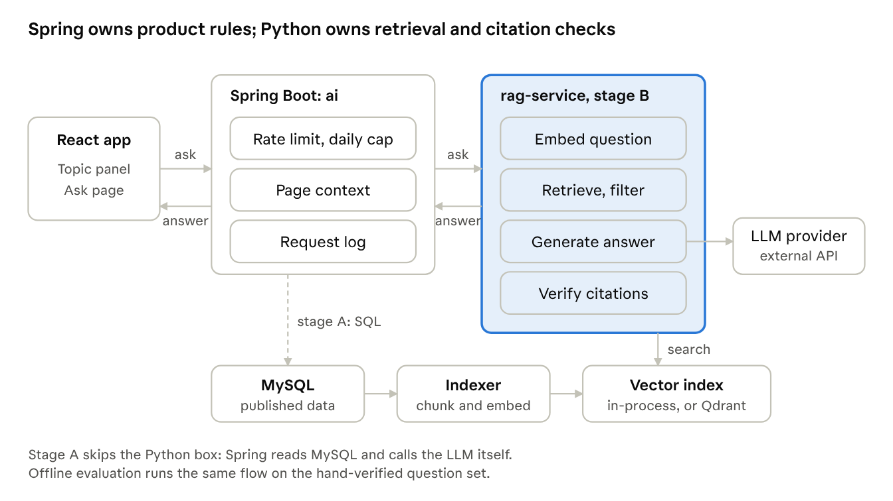

> **Working draft.** This document is a working draft (`v0.1`). It is not an approved final strategy unless explicitly adopted elsewhere.

# Exoverse — Scope Alignment: ML, AI Assistant and Roadmap v0.1

The direction you pasted fits the existing SRS, Blueprint v0.3 and the two visual documents, with one real change: Exoverse gains an intelligence layer (three ML labs and a research assistant) on top of the atlas. That layer can be added without disturbing the MVP, provided it is sequenced after the public launch and fenced behind clear contracts.

## 1. Understanding of the direction

- **The product.** An immersive digital observatory covering planets, exoplanets, stars, galaxies, extreme objects, missions and theoretical physics, written for beginners and still useful to enthusiasts, with visuals that explain science rather than decorate it.
- **The intelligence layer.** Three ML experiences built from the Space ML Project Guides (Exoplanet Finder first, then Mars Terrain Lab and Spacecraft Anomaly Detection) and an AI astronomy research assistant that answers from cited sources, in the topic page and as a global experience.
- **The principle underneath.** Scientific credibility. Provenance, uncertainty, evidence labels and honest model limitations are product features, not footnotes.
- **The build style.** One developer, a Java Spring Boot modular monolith first, Python only for ML and AI/RAG, each technology introduced when a real problem needs it, and each one taught as it arrives.
Your ten fixed decisions are kept as stated: Java primary, Python for ML and AI, Exoplanet Finder first, the other two ML projects planned, the assistant agreed, immersive and credible, no early Kafka or microservices, incremental build, provenance and citations essential, and Exoverse as the name. Two of them need a clarification rather than a change, covered in sections 3 and 5.

The ML guide's dataset figures match your message and add up: 3,600 + 9,596 + 2,541 = 15,737 signals; 55 + 27 = 82 channels; 62 + 43 = 105 anomalies. All numbers are from the guide's own descriptions of the datasets.

## 2. What the SRS and Blueprint already cover

The SRS (v1, still titled RabbitHole) predates multi-source data, ML and the research assistant. Blueprint v0.3 covers data and provenance in depth, and the AI guide only in its simplest form.

| Requirement | SRS v1 | Blueprint v0.3 | Status | Action |
| --- | --- | --- | --- | --- |
| Topic scope: planets, stars, galaxies, black holes, wormholes, multiverse, missions, spacecraft | Seven collections plus a Solar System intro; missions and spacecraft are topic types | Shared Topic model | Covered, with gaps | Nebulae, supernovae and neutron stars are not named; place them under existing collections and confirm |
| Evidence labels | FR-04: Observed, Established science, Under investigation, Theoretical, Speculative | evidence_status | Covered, names differ | Your list says "Hypothesis" where the SRS says "Under investigation"; pick one vocabulary |
| Honesty about numbers and pictures | Data policy separates observed, derived and artist impressions | value_kind for numbers; image kind for pictures | Covered | Add MODEL_PREDICTED to value_kind |
| Provenance, uncertainty, conflicting measurements | Store units, uncertainty, provenance | Section 23 measurement model | Covered | None |
| Provider integration (NASA Exoplanet Archive, NASA Images, JPL, MAST, Gaia, ESO, arXiv, Crossref, DONKI) | Not mentioned | Sections 15 to 21, provider matrix | Covered in Blueprint only | NASA ADS is missing from the matrix; verify it against official docs and add it |
| Modular monolith, Java and Spring, MySQL, Docker, Actions, AWS | Spring backend, S3 and CloudFront | Full design | Covered | None |
| No early Kafka or microservices | Not a release blocker | Kafka is a lesson only | Covered | None |
| Contextual AI on topic pages | FR-11, later phase | ai module, Spring only, plain SQL retrieval, M11 | Covered at basic level | Section 4 extends it |
| Beginner, intermediate and advanced explanations | Target users only | Not covered | New | See decision A10 |
| Research Paper Explorer | Not mentioned | arXiv and Crossref providers (M10d), no paper entity or screen | Partly | New entity and screens |
| RAG with Python, embeddings, vector store, citation checks, evaluation set | Not mentioned | "Embeddings only if needed" | New | Sections 4 and 5 |
| Global AI exploration page | Assistant "should not dominate" | Contextual panel only | Partly new | Add after the contextual version works |
| Three ML labs | Not mentioned | No ML module | New | Section 3 |
| Python service in Docker and AWS | Not mentioned | Not mentioned | New | Introduced with the first feature that needs it |
| Learning goals: ML, deep learning, RAG | Not mentioned | Learning roadmap covers 11 areas, not these | Partly | Extend the learning roadmap |
| Homepage and navigation | Visual Guide | Homepage breakdown v0.1 | Partly | No entry point to labs or assistant yet; add "Labs" and "Ask" after Release 1, with no change to the launch hero |
| Name | SRS and Visual Guide still say RabbitHole | Exoverse | Out of date | Rename in the next SRS version |

Three separate honesty axes now exist and should stay separate everywhere: the **evidence label** describes a claim, the **value kind** describes a number, and the **image class** describes a picture.

## 3. How the three ML projects fit the product

Each lab is a visual experience, not a notebook. The honest limit on all three is that a model's output is a prediction from one dataset, and it is labelled that way.

|  | Exoplanet Finder | Mars Terrain Lab | Mission Control (anomaly detection) |
| --- | --- | --- | --- |
| Experience | Browse Kepler signals: folded light curve (global and local views), prediction, confidence, simple explanation | Slider between a rover image and the predicted terrain overlay, with a class legend | Telemetry chart with threshold line and flagged events, each explained |
| Data (from the guide) | Kepler Q1 to Q17 DR24 TCE table, 15,737 labelled signals, plus light curves from MAST | AI4Mars, about 35,000 rover images; classes soil, bedrock, sand, big rock | NASA JPL SMAP and MSL telemetry, 82 channels, 105 labelled anomalies |
| Baseline to beat | Gradient boosting on period, duration and depth | Predict "soil" for every pixel | Z-score threshold on raw telemetry |
| Metrics | ROC-AUC, precision, recall; split by star | Per-class IoU, mean IoU; pixel accuracy only secondary | Event-level precision and recall |
| Training hardware | Laptop | GPU (free Colab or Kaggle per the guide) | Laptop |
| Must say on the page | Predicts candidates only; trained on Kepler data; does not confirm planets or detect life | Labels are crowdsourced and sparse; the big-rock score is unstable | Experimental; not a spacecraft safety system; two missions only |
| Guide's suggested order | Second | Third | First |

**Five decisions this implies.**

1. **Show predictions only where the model applies.** The Finder is trained on Kepler signals only, so it belongs in its own lab, listing Kepler signals, and links to a topic page only when that signal has one. It should not appear on the TRAPPIST-1e page. To my knowledge TRAPPIST-1 was not in the Kepler Q1 to Q17 data; confirm before ever showing a prediction there.
2. **Publish predictions in batches first.** Training happens offline. The model's outputs for a curated set of signals, images or channels are imported through the same reviewed staging pipeline as other data, with model version, dataset version and split recorded as provenance; value kind MODEL_PREDICTED is used only for predicted measurement values, and other results use dedicated ML result tables. This means no Python service has to run in production for the labs. A live inference service would be needed only if a feature had to score something the visitor supplies; none is planned.
3. **Keep your order, but ship in two steps.** The guide suggests anomaly detection first because it is the simplest. You chose the Finder first, which is right for the product because it matches the exoplanet focus. To keep it manageable, ship Finder v1 on the guide's tabular baseline (period, duration, depth), which needs no light-curve downloads, then add the two-view CNN (global 2,001 bins, local 201 bins) as v2.
4. **Separate the ML work from the product repository.** Notebooks, training scripts, results tables and model cards live in an exoverse-ml repository, structured as the guide recommends (data ignored by git, notebooks, source, README). The product consumes only published results and model files. This also makes the ML work a standalone portfolio piece.
5. **Quote results only from our own runs.** The guide mentions numbers from the original papers (for example about 96.7% pixel accuracy for AI4Mars and 87.5% precision with 80.0% recall for the telemetry detector). Those are the papers' results and are never shown as ours. Every lab page shows our own baseline against our own model, plus a Limitations section.
On the site, model outputs use the visualization class with a "Model prediction" label, so the image-tag system from the homepage breakdown still holds.

## 4. Where the AI research assistant fits

The assistant is one module in Spring (the planned ai module) plus, later, one Python service behind it. The browser never talks to the LLM or to Python directly. Your flow, React to Spring Boot to Python to an LLM and back with sources, is right; what needs deciding is when each part arrives.

> **Figure (from source DOCX).** assistant request flow · stage B, 8 parts

> *This figure is stored as `docs/media/Exoverse---Scope-Alignment-ML-AI-Assistant-and-Roadmap-v01.png`.*

assistant request flow · stage B, 8 parts

A question goes down through Spring's rules to the Python service; the answer returns with citation IDs that Spring renders from its own database. The highlighted service is the only part that is new in stage B.

**Three stages.**

| Stage | What it adds | Services | Why this order |
| --- | --- | --- | --- |
| A. Grounded guide (M11 in v0.3) | Contextual answers on a topic page from that topic, its related topics, sources and evidence labels; the LLM is called from Spring; retrieval is SQL | Spring only | Proves the contract, refusal behaviour, rate limits, budget cap and evaluation set with no new infrastructure |
| B. Research assistant | Python rag-service: an indexer chunks and embeds published topic text and paper abstracts; questions are answered by semantic retrieval with metadata filters, generation and citation verification | Spring plus FastAPI | Semantic search over papers is the first need SQL cannot meet, so this is where Python and embeddings earn their place |
| C. Paper explorer and global page | A research-paper entity (peer-reviewed or preprint), summaries marked as AI-generated, related papers, and the global exploration page | Same as B | Reuses B's corpus and checks |

**Who owns what in stage B.** Spring owns users, rate limits, the daily budget cap, page context, the request log and the public API. The Python service owns embeddings, retrieval, prompt assembly, generation and citation checks, and the offline evaluation. Recommendation: the Python service also calls the LLM, because citation verification needs the retrieved passages in the same place; its key then lives only in that service's secret store. The public contract (POST /ai/ask, answer plus citations) does not change between stages.

**How the science stays honest.**

- **Citations are IDs, not text.** The model is asked to cite retrieved passage IDs. We render titles, authors, dates and links from our own database. A check rejects any ID that was not retrieved, so a paper cannot be invented.
- **No verified citation, no answer.** If retrieval finds nothing relevant, the assistant says the sources do not cover it.
- **Evidence and dates travel with every passage.** Evidence label, publication date, peer-reviewed or preprint flag and provider come along as metadata, so answers can separate observation from interpretation and speculation from established science.
- **Disagreement is shown, not averaged.** For a value with several measurements the prompt gets all of them with their references, matching the measurements panel.
- **Evaluation first.** A hand-verified question set tests answer accuracy, retrieval quality, citation correctness, refusals and hallucination rate. A start of about fifty questions is enough to begin and can grow.

**What goes into the corpus, and what does not.**

- Our own published topic content and measurements: yes.
- Paper abstracts and metadata: yes, after checking terms. arXiv's metadata is CC0, which I verified earlier for Blueprint v0.3.
- Full paper text: not in the first version. Licences vary per paper.
- NASA ADS: it needs a personal API token, and its rate-limit page currently states [5,000 regular requests per day](https://adsabs.github.io/help/policies/rate-limits). Its terms of use must be read before any stored copy is used for retrieval.
- NASA, ESA and STScI web pages: licences differ by site, so each is checked before indexing.

## 5. Roadmap adjustments

Your nine stages map onto Blueprint v0.3 like this: Foundation is M0 to M2, the first full-stack feature is M3, exploration is M4, data integration is M5 (with M10 for extra providers), interactive visualizations are M6, the assistant is M11, and production is M8. The ML stages are new. Proposed changes, with reasons:

| # | Change | Technical reasoning |
| --- | --- | --- |
| 1 | Keep the public launch at M8, before ML and AI. Your Stage 9 becomes "hardening" that continues after launch | Deploying early teaches AWS, CI/CD and monitoring while the system is small, and puts real users on the core product. The Python service and GPU work would otherwise arrive in production unprepared |
| 2 | Release 2 gets an explicit order: M9 accounts, M10 extended providers, M11a grounded guide, M12 Exoplanet Finder, M13 research assistant, M14 Mars Terrain Lab, M15 Mission Control | Each step adds at most one new runtime or concern. The Finder before the assistant keeps the first Python work offline and low-risk |
| 3 | Split the assistant: M11a is Spring only, M13 adds the Python service | Stage A proves the contract and cost controls cheaply. Python and embeddings arrive only when paper retrieval needs them |
| 4 | M13 depends on M10d (arXiv and Crossref) and on M11a | The paper corpus needs the paper providers; the evaluation set needs the stage A contract |
| 5 | Accounts (M9) are not a prerequisite for ML labs, and become optional for the assistant | v0.3 decision D9 already allows per-IP limits and a hard daily budget cap instead of signed-in users |
| 6 | Add NASA ADS to the M10 provider verification | It is in your source list and missing from the provider matrix |
| 7 | Kafka, Redis and OpenSearch stay out | Reindexing after a publish and batch scoring can run as a scheduled job reading a status table. Kafka stays a concept lesson until several independent consumers need the same event stream |
| 8 | Model files and masks live in S3 with the existing media delivery, never in MySQL | Same rule as images and 3D models in v0.3 |

The notebooks for the Finder can start before M12, as a learning break from Java, because they do not touch the product. That is your call (question A-Q4).

**Vector store evaluation.** Not finalized, as you asked. Candidates, judged on what this project needs: filtering by evidence label and date, simple operation for one developer, and learning value.

| Option | Fits when | Concern | Verdict |
| --- | --- | --- | --- |
| In-process index built by the indexer (NumPy or FAISS) and loaded by the Python service | Small corpus, rebuilt on each publish | Metadata filtering is done in code; no live updates; limits are my estimate and must be measured | Start here |
| MySQL VECTOR column | You want vectors beside the relational data | The VECTOR type stores data, but Oracle's manual says DISTANCE() is available only in HeatWave and MySQL AI, not in Community or Commercial MySQL (manual 9.5; re-check for the version we run) | Not usable for similarity search on plain MySQL |
| Qdrant | Corpus or filters outgrow the in-process index; you want to learn a vector database | One more service to run, secure and back up; licence, hybrid search and small-instance needs to be verified from official docs | Candidate for the bake-off |
| OpenSearch | One engine for keyword and vector search, possibly also for the Search module | Heavy for one developer to run; already listed as "only when justified" | Defer |

Decision rule: once the evaluation set exists, run the same questions against the in-process index and Qdrant, compare retrieval hit rate, latency and operating effort, and choose from those results.

## 6. Is this practical for one developer?

Yes for the MVP, the grounded guide and the first ML lab. The full list is a multi-year roadmap, which is fine if the rule is one new runtime or major concern per release. Pushing back on a few items:

- **Total scope.** Java, React, 3D, AWS, three ML projects and a RAG system are each a serious learning curve. Done together they would stall the launch. The M8 gate protects against that: nothing in this document adds to Release 1.
- **Rough effort for the new work** (part-time, learning included, guesses to be revised after the first one): Finder v1 3 to 4 weeks, Finder CNN 3 to 4, assistant stage A 3 to 4 (already in v0.3), research assistant 5 to 7, Mars lab 4 to 6, Mission Control 3 to 4.
- **The evaluation set is real work.** Hand-verifying answers and citations will take longer than building the first retrieval version. Budget for it.
- **Running costs appear.** LLM API calls need a monthly ceiling (question A-Q2). The Mars model needs a GPU only for training, which the guide runs on free notebooks.
- **Credibility risk is the one to manage most.** A confident-looking wrong prediction or answer does more damage than a missing feature. That is why labels, model cards and refusal behaviour are in scope before any lab ships.

## 7. Decisions and questions

No code or architecture is final until you answer. Five of these (A1, A2, A3, A5, A6) shape the next documents.

| ID | Decision | Recommendation |
| --- | --- | --- |
| A1 | Evidence label vocabulary | Use your five: Observed, Established, Theoretical, Hypothesis, Speculative. Show "under investigation" as the plain-language hint for Hypothesis |
| A2 | Finder before the guide's anomaly-first order | Keep; ship v1 on the tabular baseline, then the CNN |
| A3 | Predictions batch-published, not live | Yes, until a feature needs live scoring |
| A4 | Separate exoverse-ml repository | Yes |
| A5 | Public launch stays at M8 | Yes; ML and AI follow |
| A6 | Who calls the LLM in stage B | The Python service |
| A7 | Vector store | In-process first, bake-off against Qdrant on the evaluation set |
| A8 | Corpus | Own content plus paper abstracts; no full text at first |
| A9 | New value_kind MODEL_PREDICTED; model outputs tagged as visualization with a "Model prediction" label | Yes |
| A10 | Beginner, intermediate and advanced levels | The assistant adapts its explanation level; topic pages keep one authored level plus a "go deeper" link |

**Questions for you.**

- A-Q1. Are you comfortable launching the atlas at M8 without any ML or AI, given your portfolio goals?
- A-Q2. What monthly ceiling should LLM spending have?
- A-Q3. Do you have a local GPU, or will Mars training use free Colab or Kaggle?
- A-Q4. Should the Finder notebooks start early, alongside the first foundation milestones, as a break from Java?
- A-Q5. Once you approve, shall I produce SRS v2 (renamed, with ML, assistant and evidence-label changes), Blueprint v0.4 (new modules, M11a to M15, MODEL_PREDICTED) and the visual-guide changes for the Labs and assistant?
