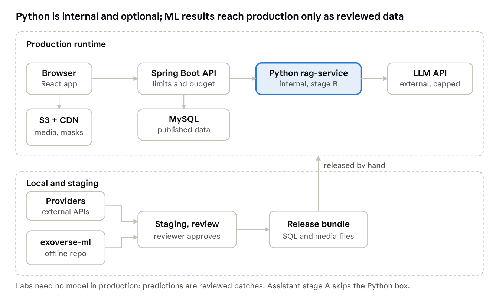
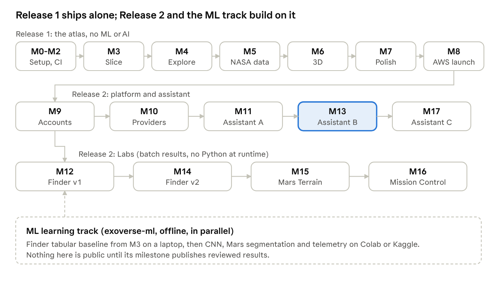

# Exoverse — Technical Blueprint v0.4


Blueprint v0.4 extends v0.3 with the agreed machine-learning and AI scope: three ML Labs (Exoplanet Finder, Mars Rover Terrain Segmentation, Spacecraft Anomaly Detection) and the AI Astronomy Research Assistant. It is written as a controlled extension: every section that changed or is new is restated here in full, and a status table shows what happens to each v0.3 section, so nothing is silently removed. v0.3 remains the base text for sections marked Unchanged. Java Spring Boot stays the primary backend; Python is the specialized ML and AI layer. No application code has been written.

## 1. Change log and v0.3 section status

**What changed from v0.3**

| Area | v0.3 | v0.4 |
| --- | --- | --- |
| Scope | Atlas plus a simple grounded AI guide (M11) | Adds exactly three ML Labs and a three-stage assistant; no other ML project |
| Evidence vocabulary | evidence_status (SRS v1 labels) | Observed, Established, Theoretical, Hypothesis, Speculative; separate research_status for "Under investigation" |
| Value kinds | MEASURED, DERIVED, ESTIMATED, THEORETICAL | Adds MODEL_PREDICTED for predicted measurement values only |
| ML results | None | New tables for model versions, predictions, artifacts and anomaly events, published through the reviewed ingestion path |
| Services | One Spring Boot deployable | Adds an internal Python FastAPI service from assistant stage B; the ML training code is a separate exoverse-ml repository |
| AI | Spring only, SQL retrieval, LLM called from Spring | Stage A as before; stage B Python service with embeddings, in-process index, RAG and citation verification; stage C paper explorer and global page |
| Spending | Budget cap "to decide at M11" | ₹500 monthly planning ceiling with limits and a hard control, enforced before every paid call |
| Milestones | M0 to M11 | M0 to M8 unchanged; Release 2 becomes M9 to M17; parallel ML learning track |
| Security | Web and provider risks | Adds internal-service authentication, prompt injection, model-file safety and spend abuse |

**Status of every v0.3 section**

| v0.3 section | Status in v0.4 | Where |
| --- | --- | --- |
| 1 Review of SRS and Visual Guide | Superseded by SRS v2 and Visual Guide v2 | Section 8 (gaps) |
| 2 Gaps G1 to G11 | Kept; new gaps G12 to G17 added | Section 8 |
| 3 Final MVP scope | Unchanged: Release 1 is M0 to M8 | n/a |
| 4 System architecture | Amended | Section 2 |
| 5 Backend modules | Amended: ml, research, ai changes | Section 3 |
| 6 MySQL design | Amended: new tables and enums | Section 3 |
| 7 REST API | Amended: new endpoints | Section 6 |
| 8 Frontend | Amended: Labs and assistant UI | Section 6 |
| 9 GitHub | Amended: exoverse-ml, milestones M9 to M17 | Section 6 |
| 10 CI/CD, Docker, AWS | Amended | Section 6 |
| 11 Milestones | M0 to M8 unchanged; Release 2 replaced | Section 7 |
| 12 Learning roadmap | Extended | Section 7 |
| 13 Master roadmap | Phases 1 to 11 unchanged; phases for M9 to M17 added | Section 7 |
| 14 Decisions | Extended: C8 to C20, D17 to D26, Q12 to Q16 | Section 8 |
| 15 Multi-source architecture | Unchanged; exoverse-ml is an internal provider | Section 4 |
| 16 Provider matrix | Amended: NASA ADS added, to verify | Section 8 |
| 17 Adapter design, 18 DB changes | Unchanged (18 superseded where section 3 differs) | n/a |
| 19 Ingestion workflow | Extended: ML result batches | Section 4 |
| 20 Integration roadmap, 21 Integration learning plan | Unchanged | n/a |
| 22 Risks R1 to R15 | Kept; R16 to R25 added | Section 8 |
| 23 Versioning and provenance | Extended for ML | Sections 3 and 4 |
| 24 Consistency review | Re-run against SRS v2 and Visual Guide v2 | Section 8 |

## 2. Scope and architecture

**Scope.** Release 1 is the atlas (M0 to M8, unchanged from v0.3). Release 2 (M9 to M17) adds accounts, extra providers, the assistant in three stages and exactly three ML Labs: Exoplanet Finder, Mars Rover Terrain Segmentation and Spacecraft Anomaly Detection. The assistant is a separate AI and RAG feature. No other ML project is in the architecture or the roadmap unless you propose it.



> **Figure (from source DOCX).** system architecture v0.4 · runtime and data path

> *This figure is stored as `docs/media/Exoverse---Technical-Blueprint-v04-image1.png`.*

system architecture v0.4 · runtime and data path

The top box is what runs in production; the bottom box is where data is prepared and reviewed before it is released. The highlighted Python service is the only new runtime and arrives with assistant stage B.

**Architecture rules.**

1. The browser talks only to the CDN and the Spring Boot API. Spring Boot is the only public backend; it owns the public API, authentication, user limits, rate limits, the spending budget and orchestration.
2. The Python service has no public endpoint, accepts calls only from Spring Boot over a private network with an authentication token, and holds no write access to MySQL.
3. ML training happens offline in exoverse-ml (laptop, free Colab or Kaggle). No model runs in production for the Labs: results are imported as reviewed batches, exactly like provider data.
4. Datasets and model files are never committed to GitHub. A manifest of names, sizes and checksums is committed; the files live in private storage.
5. The atlas never depends on AI or ML services. If the Python service, the LLM or the spending cap is unavailable, the assistant shows an unavailable state and everything else keeps working.
6. Evidence label, value kind, image class and ML result type remain separate concepts everywhere in code, data and UI.

## 3. Backend modules and data model

### 3.1 Modules

v0.3 modules are kept. Changes and additions:

| Module | Owns | Depends on | Arrives | Change |
| --- | --- | --- | --- | --- |
| topics | Topics, property definitions, measurements, evidence label, research status | media, sources | M3 | Evidence vocabulary and research status |
| ingestion | Runs, staging, validation, review, publication | integration, topics, ml | M5 | Also publishes reviewed ML result batches |
| ml | Model versions, predictions, artifacts, anomaly events, Labs read APIs | ingestion, media, topics | M12 | New. Has no client for Python: results are batch data only |
| ai | Questions, limits, spending ledger, request log, retrieval client | topics, users | M11 | Amended: one RagClient interface with two implementations, SQL retrieval (stage A) and a Python HTTP client (stage B) |
| research | Papers, paper summaries, paper relations | integration, topics, ai | M17 | New |

The RagClient interface is the seam between stage A and stage B. The ai module's controllers, limits, ledger and logging do not change when the Python service arrives; only the implementation behind the interface does.

### 3.2 Evidence, research status and value kinds

- evidence_label ENUM: OBSERVED, ESTABLISHED, THEORETICAL, HYPOTHESIS, SPECULATIVE. It replaces v0.3's evidence_status on topics, measurements and experiences. Nothing has been built, so no data migration is needed; it is defined in the first M3 migration.
- topic.research_status ENUM: NONE (default), UNDER_INVESTIGATION, with an optional short note. It is independent of the evidence label: a hypothesis may or may not be under active investigation, and an established result may still have open follow-up work.
- value_kind ENUM: MEASURED, DERIVED, ESTIMATED, THEORETICAL, **MODEL_PREDICTED**. The last is used only for a predicted measurement value stored in topic_measurement. Classifications, masks and anomaly events never go there.

### 3.3 ML result structure

Three kinds of result need three suitable shapes, so they share model, version and provenance tables and differ only in how the prediction is stored.

| Table | Purpose | Key columns |
| --- | --- | --- |
| ml_model | One row per Lab model | slug, lab (EXOPLANET_FINDER, MARS_TERRAIN, MISSION_CONTROL), task type (CLASSIFICATION, SEGMENTATION, ANOMALY_DETECTION), title, summary |
| ml_model_version | One trained, evaluated version | model, version label, kind (BASELINE or DEEP), algorithm, training dataset and dataset version, split policy, code repository commit, training environment (LAPTOP, COLAB, KAGGLE), random seed, our evaluation metrics (JSON), baseline version compared against, limitations, model card text, private artifact key and checksum, status |
| ml_prediction | One prediction for one subject | model version, subject type (KEPLER_SIGNAL, ROVER_IMAGE, TELEMETRY_CHANNEL), subject reference, optional topic link, predicted label, score, class scores (JSON), plain explanation, the dataset's own label where known, data split (TRAIN, VALIDATION or TEST), input checksum, verification and publication status, ingestion run. Unique on model version and subject reference |
| ml_prediction_artifact | Files tied to a prediction | prediction, kind (FOLDED_GLOBAL, FOLDED_LOCAL, SOURCE_IMAGE, MASK, OVERLAY, TELEMETRY_SERIES), media asset, checksum |
| ml_anomaly_event | Anomaly events on a channel | prediction, origin (MODEL_FLAG or EXPERT_LABEL), start and end step, peak score, threshold, label type (POINT or CONTEXTUAL) where known, matched event |

Design notes:

- Recording the **data split** lets each Lab page say whether a signal or image was used in training, which keeps displayed results honest.
- Expert-labelled anomalies are stored as events too, so Mission Control can show flagged, correct and missed events side by side.
- Masks, overlays, folded light-curve views and telemetry series are files that reuse media_asset (storage key, licence, credit) and the existing CDN delivery. MySQL stores only the references.
- Predictions are published through the same staging and review path as provider data (section 4). Each carries model version and dataset version, so a result can always be traced.

### 3.4 AI and research tables

| Table | Arrives | Purpose |
| --- | --- | --- |
| ai_request_log (amended) | M11 | Per request: user or hashed IP, topic, explanation level, stage, outcome (ANSWERED, REFUSED_NO_SOURCE, REFUSED_LIMIT, REFUSED_CAP, ERROR), token counts, estimated cost in paise, latency, number of citations. Never the raw IP |
| ai_user_usage | M11 | Requests per user per day, for the daily limit |
| ai_spend_ledger | M11 | One row per month: cap, amount spent, amount reserved. Updated atomically so the cap cannot be exceeded under concurrency |
| rag_chunk | M13 | Metadata for each indexed passage: source kind (TOPIC_TEXT, MEASUREMENT, PAPER_ABSTRACT), source id, chunk position, text checksum, index version, evidence label, publication date. Citations resolve to these rows |
| research_paper | M17 | Source, external identifier or DOI, title, authors, publication date, venue, peer-review status (PEER_REVIEWED, PREPRINT, UNKNOWN), abstract, licence note, retrieval date, URL, content hash, statuses |
| topic_paper | M17 | Links a paper to a topic with a relevance note |
| paper_summary | M17 | AI-generated summary, findings and limitations, with generating model, prompt version and review status; always shown as AI-generated |
| paper_relation | M17 | Related papers: cites, cited by, similar |

Indexes: ml_prediction unique (model version, subject reference) plus (model version, publication status, subject type) and (topic); ml_anomaly_event (prediction, start step); rag_chunk (source kind, source id) and (index version); research_paper unique (provider, external id) and (publication date); ai_request_log (created at) and (user, created at).

That is 12 new tables plus the amended ai_request_log. The vector index itself is not a MySQL table.

### 3.5 ER diagram (new tables and their links)

```
erDiagram
  ml_model ||--o{ ml_model_version : has
  ml_model_version ||--o{ ml_prediction : produces
  external_dataset ||--o{ ml_model_version : trained_on
  ml_prediction ||--o{ ml_prediction_artifact : has
  media_asset ||--o{ ml_prediction_artifact : stores
  ml_prediction ||--o{ ml_anomaly_event : contains
  topic |o--o{ ml_prediction : links_to
  ingestion_run ||--o{ ml_prediction : published_by
  app_user |o--o{ ai_request_log : asks
  app_user ||--o{ ai_user_usage : counts
  topic |o--o{ ai_request_log : context
  topic ||--o{ rag_chunk : indexed_as
  research_paper ||--o{ topic_paper : cited_in
  topic ||--o{ topic_paper : has
  research_paper ||--o{ paper_summary : summarized_by
  research_paper ||--o{ paper_relation : relates
  ml_model { varchar slug enum lab enum task_type }
  ml_model_version { varchar version enum kind varchar dataset_version char code_commit json metrics varchar artifact_sha256 }
  ml_prediction { enum subject_type varchar subject_ref varchar predicted_label decimal score enum split }
  ml_anomaly_event { enum origin int start_step int end_step decimal peak_score }
  ai_spend_ledger { char month int cap_paise int spent_paise int reserved_paise }
  research_paper { varchar external_id enum peer_review_status date published_on }
```

## 4. ML integration

### 4.1 Publication path

Training and evaluation happen offline in the exoverse-ml repository. Results reach the product only as a reviewed bundle, the same way provider data does (v0.3 section 19).

1. **Develop and train** in exoverse-ml on a laptop, free Colab or free Kaggle.
2. **Evaluate** on data held out from training and tuning, against the simple baseline, and record results with seeds and checksums.
3. **Export a result bundle**: manifest.json (bundle schema version, model and version label, dataset and version, code commit, seed, creation time, file checksums), predictions.jsonl, metrics.json, model_card.md and an artifacts/ folder (masks, overlays, folded light-curve series, telemetry series).
4. **Import** in the local or staging environment through an internal exoverse-ml provider adapter in the ingestion module. It checks the schema version, checksums, row counts and label sets, then stages the rows. Nothing is published yet.
5. **Review**: a reviewer inspects metrics, a sample of predictions and artifacts, and the model card, then approves or rejects each version.
6. **Release** through a dedicated, reviewed bundle importer or publishing job that writes the prediction rows and syncs the files, run by an admin until the production review screen exists (M9 onward). The same path serves NASA data. Flyway stays for schema migrations only, never for prediction data.
7. **Retire**, never delete: a new model version adds new rows; the old version is marked RETIRED and stays traceable.
Import is idempotent: predictions are unique per model version and subject, so re-importing a bundle cannot create duplicates. Bundles contain plain data files only. No pickled or otherwise executable model files are ever loaded by the product.

### 4.2 The three Labs

|  | Exoplanet Finder | Mars Terrain Lab | Mission Control |
| --- | --- | --- | --- |
| Subject | Kepler Q1 to Q17 DR24 TCE signals from the NASA Exoplanet Archive | AI4Mars rover images | SMAP and MSL telemetry channels from the NASA JPL anomaly dataset |
| v1 / first model | Gradient boosting on catalogue features (period, duration, depth); runs on a laptop | DeepLabV3+ with a pretrained ResNet-50 encoder, trained on a GPU (Colab or Kaggle) | One LSTM per channel on 250-step windows, with smoothed errors and a dynamic threshold |
| Later model | v2: two-view 1D CNN, global view 2,001 bins and local view 201 bins, from light curves downloaded from MAST | None planned | None planned |
| Baseline | Gradient boosting (v1 itself is the baseline for v2) | Predict "soil" for every pixel | Z-score threshold on raw telemetry |
| Split rule | Split by star: all signals of one star in one split | Keep the expert-labelled test set untouched until the end | Never tune the threshold on the labelled anomalies used for reporting |
| Metrics shown (our own) | ROC-AUC, precision, recall | Per-class IoU, mean IoU; pixel accuracy secondary | Event-level precision and recall |
| Published per subject | Class, score, explanation, truth label, split, folded views (v2) | Mask and overlay files, split | Series with predicted values, error and threshold; flagged and labelled events |
| Frontend | Signal browser, light-curve chart, prediction panel | Image slider between original and overlay, class legend | Telemetry chart with threshold and events, baseline comparison |
| Milestone | M12 (v1), M14 (v2) | M15 | M16 |

Points that apply to all three:

- Every Lab page shows the model version, our own results against the baseline, the data split of the item shown, a Limitations section and a link to the model card. Numbers reported in papers are never displayed as ours.
- The Exoplanet Finder predicts candidates. It does not confirm planets or detect life, and a topic page link appears only where a topic exists for that signal. The Kepler DR24 table's column names and label definitions are checked against the Archive's documentation at the start of M12 (to verify).
- Mission Control shows downsampled series for display and says so. It is labelled experimental and not a spacecraft safety system.
- Displayed items are chosen by the reviewer (a curated set per Lab, size decided in each milestone), not the whole dataset.
- Image and telemetry credits and licences are recorded per asset. NASA media guidelines apply, as in v0.3.

### 4.3 The exoverse-ml repository

- **Layout:** data/ (git-ignored; only small checksum manifests are committed), notebooks/, src/exoverse_ml/ (data, features, models, evaluation, export), tests/, results/ (small metrics tables), model_cards/, docs/, a pinned environment file and a README that opens with the one-line summary, results table and limitations.
- **No large files in GitHub.** .gitignore covers datasets, model weights and arrays; a size check in pre-commit and CI rejects large files (a 1 MB threshold is proposed). Git LFS is not used.
- **Where artifacts live:** a private storage location with checksums recorded in committed manifests. Recommended: a private S3 prefix (open question Q16). Colab sessions use temporary storage and upload final files.
- **Reproducibility:** fixed seeds, a runs table written at every training run, dataset checksums, a locked environment, and the code commit recorded in each bundle.
- **Tests:** a check that no star appears in two splits, unit and bin-count checks, a schema test for exported bundles and a golden-file test for the importer fixtures.
- **CI:** lint and the tests above on small fixtures. Training never runs in CI.

### 4.4 Model cards

Every published version has a card with: purpose and what it must not be used for; data source, version and label definitions; method; split policy; our baseline-versus-model table with test-set size; error analysis; limitations; reproducibility details (commit, seed, environment, hardware); and version history. The product renders the card from stored text. Context from published papers may appear only in a separate, cited "from the literature" note.

### 4.5 When live inference may be introduced

Not in this roadmap. If a future feature must score visitor-supplied or very large unseen input, that is a change to SRS v2. The likely shape would be a second internal Python endpoint behind Spring Boot, reusing the rag-service pattern, with the same authentication and limits. It is deliberately not designed now.

## 5. AI and RAG architecture

### 5.1 Three stages

| Stage | Milestone | What it is | Runtime |
| --- | --- | --- | --- |
| A | M11 | Topic-page assistant. Spring Boot retrieves published topic text and measurements with SQL (keyword and structured lookup) and calls the LLM API directly | Spring Boot only |
| B | M13 | Python rag-service (FastAPI): embeddings, semantic retrieval, RAG, citation verification. Spring Boot calls it over a private network | Spring Boot + Python |
| C | M17 | Research Paper Explorer, paper summaries and the global Ask page, on top of the stage B service | Spring Boot + Python |

Stage A ships the whole user-facing contract (limits, citations, refusals, explanation levels, ledger) so stage B changes only what sits behind the RagClient interface.

### 5.2 Responsibilities

- **Spring Boot owns:** the public endpoints, authentication, per-user and per-IP limits, rate limits, the monthly spending budget, request logging, orchestration, and rendering of citations from database rows.
- **Python owns:** chunking, embeddings, the vector index, retrieval and reranking, prompt assembly, the LLM call, and citation verification. It never talks to the browser.
- **Internal contract (stage B):** POST /internal/v1/answer receives question, topic id (optional), explanation level, maximum output tokens and a request id. It returns answer text, the retrieved passage ids, the verified citation ids, a refusal reason if any, token counts and index version. Calls carry a shared-secret bearer token, travel over a private network only, and time out at 20 seconds with one retry at most. Spring Boot treats every response as untrusted input and re-checks the ids against rag_chunk.

### 5.3 Request flow

1. Spring Boot authenticates, checks the user's daily limit, the IP rate limit and the monthly cap, and **reserves** an estimated cost in ai_spend_ledger. Any failure returns a clear refusal before the LLM is called.
2. It calls RagClient.answer (SQL retrieval in stage A, Python in stage B).
3. Retrieved passages are placed in the prompt as data; the system prompt tells the model to answer only from them.
4. The model's answer must cite passage ids. The verifier checks each cited id was actually retrieved, and that each answer sentence with a factual claim has a supporting citation. Unverified sentences are removed. If nothing verified remains, the response is "not in the sources".
5. Spring Boot resolves ids to topic, section, source title and URL from the database and sends the answer to the browser. Evidence label, date and peer-review status come from the passage metadata, never from the model.
6. The reservation is settled to actual cost, and one ai_request_log row is written.

### 5.4 Explanation levels

Beginner, Intermediate and Advanced change the system prompt's reading level, vocabulary and use of equations. They never change which passages are retrieved, so the facts and citations stay the same. The default is Intermediate and the user's choice is remembered per account. Level names and prompt versions are stored with each logged request.

### 5.5 Corpus and licensing

Indexed: Exoverse's own published topic text and measurements, scientific metadata, and paper **abstracts** from providers that allow it (arXiv metadata, NASA ADS metadata and abstracts, subject to each provider's terms). Not indexed: full paper text, until licensing for each source has been checked. Each paper record stores source, retrieval date, licence note and a content hash. Provider terms are re-checked before a source is added to the index (open question Q12).

### 5.6 Vector search

- **First choice:** an in-process index inside the Python service, built from rag_chunk text at deploy time. At this corpus size (low thousands of chunks) exact search is fast and has no extra service to operate. The index is versioned and rebuilt, not updated in place.
- **Why not MySQL:** its VECTOR type can store embeddings, but the DISTANCE() function is available only in HeatWave and MySQL AI, not in the Community or Commercial editions we would run. Re-verified against the Oracle manual for versions 9.5 and 9.6.
- **Qdrant later, if justified:** evaluated against the same evaluation set, comparing retrieval quality, latency, memory use and operational cost. The decision is deferred and not committed to (decision D23).

### 5.7 Embeddings and model choice

One embedding model and one answer model are chosen at the start of M13 by running the evaluation set, within the budget. Both are configuration, not code. A hosted embedding API and a small local model are compared on retrieval quality and cost; the cheaper option that meets the retrieval target wins. Model names are not fixed here (to verify at the start of M13).

### 5.8 Spending control (₹500 per month)

- **Hard cap in the database:** ai_spend_ledger holds the month's cap in paise. A request reserves its estimated worst-case cost with an atomic conditional update; if the reservation does not fit, the request is refused. After the call the reservation is settled to actual usage.
- **Per-request limits:** a maximum number of input passages, a maximum question length, a maximum output token count, and a short timeout.
- **Per-user and per-IP limits:** daily request counts (defaults to be tuned, starting small), plus a burst rate limit. Anonymous use is not allowed on the assistant; users must be signed in.
- **Provider-side cap:** a monthly spending limit is set in the LLM provider's own console as a second line of defence.
- **Cache:** repeated identical questions about the same topic and level return the stored verified answer without a new LLM call, until the index version changes.
- **Degradation order:** warn at 80% of budget, switch to cached answers and shorter outputs at 90%, show "assistant paused until next month" at 100%. The atlas is unaffected.
- **Review:** the ledger is reviewed monthly; the cap is a planning ceiling, not a promise that it suffices (risk R19).

### 5.9 Security for AI

- Retrieved text and user questions are treated as data, never instructions. Prompts mark them clearly and the system prompt forbids following instructions inside them (prompt injection, risk R21).
- The model has no tools, no network access and no database access. It only returns text.
- Output is rendered as plain text or sanitised markdown, never as HTML.
- Logs keep question text only if needed for evaluation, for a short retention period, and never alongside an IP address or email. Personal data is minimised and a user can delete their history.
- The service token is rotated and kept in secrets storage, not in the repository.

### 5.10 Evaluation

A hand-verified set starts at about 50 questions with expected answer points and expected source passages, and grows to cover every stage. It includes questions the corpus cannot answer (the correct result is a refusal), conflicting-source questions and injection attempts. Measured every time the prompt, model, chunking or index changes:

- answer accuracy (checked by me against the reference, with spot checks by you)
- retrieval quality (is the expected passage in the top results?)
- citation correctness (does each cited passage support its sentence?)
- correct refusals on unanswerable questions
- hallucination rate (claims with no supporting passage)
Targets are agreed once the first baseline is measured, not guessed now (decision D25). Results are stored with the prompt, model and index versions so changes can be compared.

### 5.11 Research Paper Explorer (stage C)

Papers are fetched through the existing provider and ingestion path, staged, reviewed and published like any other data. A paper page shows metadata, abstract, peer-review status (PEER_REVIEWED, PREPRINT or UNKNOWN), the topics it relates to, and a generated summary clearly marked AI-generated with its limitations. Summaries are based on the abstract only and pass the same citation verification. Where papers disagree, the page shows both positions with their evidence labels and does not average or pick a winner. The global Ask page uses the same endpoint as the topic panel with no topic context.

## 6. API, security, delivery and operations

v0.3 conventions are unchanged (versioned /api/v1, DTOs not entities, consistent error shape, pagination, OpenAPI). This section lists only what is added or amended.

### 6.1 API additions

| Endpoint | Auth | Arrives | Purpose |
| --- | --- | --- | --- |
| GET /api/v1/labs | public | M12 | List the three Labs with current model version |
| GET /api/v1/labs/{lab}/model | public | M12 | Model card text, our metrics, baseline comparison, limitations |
| GET /api/v1/labs/exoplanet-finder/signals | public | M12 | Curated signals with filters, paginated |
| GET /api/v1/labs/exoplanet-finder/signals/{ref} | public | M12 | One signal: prediction, score, truth label, split, views |
| GET /api/v1/labs/mars-terrain/images and /images/{ref} | public | M15 | Curated images with mask and overlay URLs |
| GET /api/v1/labs/mission-control/channels and /channels/{ref} | public | M16 | Channels, series, threshold, flagged and labelled events |
| POST /api/v1/ai/ask | signed in | M11 | Ask a question (topic optional), with explanation level |
| GET /api/v1/ai/usage | signed in | M11 | Remaining daily requests and assistant availability |
| DELETE /api/v1/ai/history | signed in | M11 | Delete the user's stored question history |
| GET /api/v1/papers, /papers/{id} | public | M17 | Paper explorer |
| GET /api/v1/topics/{slug}/papers | public | M17 | Papers related to a topic |
| POST /internal/v1/answer (Python) | service token | M13 | Internal only, not routed publicly |
| GET /api/v1/features | public | M9 | Release flags for navigation: accounts (M9), labs (true once a Lab is published), ask (true once the global Ask page is live). The frontend shows only destinations flagged on; no empty or coming-soon links |

Lab endpoints return only PUBLISHED rows. Ask responses include answer text, citations (title, section, link, evidence label, date), refusal reason, and remaining limit. Admin import and review endpoints extend the v0.3 set with ML bundle import and version approval.

### 6.2 Security additions

| Area | Decision |
| --- | --- |
| Assistant access | Signed-in users only; limits per user and per IP; monthly cap enforced in the database |
| Service-to-service | Private network, bearer token from secrets storage, no public route to Python, token rotation procedure documented |
| Prompt injection | Retrieved text treated as data, no model tools, output sanitised, citations resolved from the database (section 5.9) |
| Model files | Bundles contain data only; no pickle or executable artifacts are loaded by the product |
| Cost abuse | Reservations before calls, small output limits, cache, provider-side cap |
| Privacy | Question logs minimised, short retention, deletable by the user, never joined to raw IP or email |
| Dependencies | Python dependencies pinned and scanned in CI alongside the Java ones |
| Upload surface | None added: there are no user uploads in any Lab or in the assistant |

### 6.3 Docker and environments

- Local Compose adds one optional rag-service container from M13. It is not needed for the atlas or for stage A.
- The exoverse-ml repository runs in its own Python environment on the laptop, Colab or Kaggle; it is not part of the product containers.
- Production adds one container for Python on the same EC2 host as Spring Boot, with the port closed to the internet. A second host is considered only if memory demands it.

### 6.4 CI/CD

- Backend and frontend pipelines are as in v0.3.
- rag-service gets its own pipeline: lint, type check, unit tests, an evaluation-set smoke test on a tiny fixture index, container build and dependency scan. The full evaluation runs manually before a release.
- exoverse-ml runs lint, unit and schema tests and the large-file check. Training never runs in CI.
- A release that changes the prompt, model or index version must include an evaluation report.

### 6.5 Testing

| Layer | What is tested |
| --- | --- |
| Spring Boot | Limit and ledger logic (including concurrent requests against the cap, with Testcontainers MySQL), citation rendering, refusal paths, bundle import validation and idempotency |
| Contract | The internal answer endpoint, with Spring Boot tested against a stub and the Python service tested against recorded requests |
| Python | Chunking, retrieval on a tiny fixed corpus, citation verification (a cited id that was not retrieved must be rejected), refusal on empty retrieval |
| Evaluation | The hand-verified set, run on demand and before every release that changes the assistant |
| Frontend | Lab components with fixture data, assistant states (loading, answer, refusal, limit reached, unavailable), keyboard and screen-reader checks |
| ML repo | Star-level split test, bundle schema test, importer golden files |

### 6.6 Monitoring and cost visibility

Beyond v0.3 monitoring: LLM spend against the cap, requests by outcome, refusal rate, average citations per answer, retrieval latency, LLM latency, Python service health and cache hit rate. An alert fires at 80% of budget and on any spike in errors from the internal service. All of this is read from ai_request_log and ai_spend_ledger first; a metrics stack is not added for it.

## 7. Milestones and learning

The roadmap matches SRS v2 section 12. M0 to M8 are unchanged from v0.3 and still launch the atlas without ML or AI. Milestones are ordered by dependency, not by calendar; no dates are promised.



> **Figure (from source DOCX).** milestone dependencies v0.4

> *This figure is stored as `docs/media/Exoverse---Technical-Blueprint-v04-image2.png`.*

milestone dependencies v0.4

### 7.1 Release 2 milestones

| Milestone | Delivers | Needs | Exit check |
| --- | --- | --- | --- |
| M9 Accounts | Registration, login, saved topics, history; ADMIN review screen in production | M8 | A user can sign up, save a topic and delete the account; reviewer approves a record in production |
| M10 Extended providers | JPL, MAST, Gaia, arXiv, Crossref; NASA ADS if the terms check passes (to verify) | M5, M9 | New data arrives only through staging and review; provider terms recorded |
| M11 Assistant stage A | Topic-page assistant, Spring Boot and SQL retrieval, limits, ledger, explanation levels, refusals | M9 | Cap cannot be exceeded under concurrent requests; unsourced questions are refused |
| M12 ML result platform and Finder v1 | ml module and tables, dedicated reviewed bundle importer or publishing job (separate from Flyway schema migrations), review, Labs area, tabular baseline results | M5, M9 | A bundle imports twice without duplicates; reviewer approves; Lab page shows our results and limitations |
| M13 Assistant stage B | Python rag-service, embeddings, in-process index, citation verification, evaluation set | M11 | Evaluation report recorded; a fabricated citation id is rejected in tests |
| M14 Finder v2 | Two-view CNN results beside the baseline, folded views | M12 | Comparison against v1 on the same star-level split published |
| M15 Mars Terrain Lab | Segmentation overlays, per-class results, comparison slider | M12 | Test set untouched until the final evaluation; per-class IoU published |
| M16 Mission Control | Telemetry chart, threshold, flagged and labelled events, baseline comparison | M12 | Event-level results published against the z-score baseline |
| M17 Assistant stage C | Research Paper Explorer, summaries, global Ask page | M10, M13 | Paper pages show peer-review status; summaries pass citation verification |

M12, M14, M15 and M16 do not depend on the assistant, and M11 does not depend on any Lab, so the two tracks can be reordered if one proves harder than expected.

### 7.2 ML learning track (offline, in parallel)

This follows your decision to start experimenting once the Java foundation is underway. It lives in exoverse-ml and has no public deadline.

1. **From M3:** Finder baseline on a laptop. Learn data loading, star-level splits, gradient boosting, ROC-AUC, precision and recall, and why a split mistake inflates results.
2. **Around M8 to M10:** reproducible runs, model cards and the result bundle format, so M12 only has to import them.
3. **Before M14:** light-curve folding, binning and the two-view CNN on Colab or Kaggle.
4. **Before M15:** segmentation basics, IoU, pretrained encoders and class imbalance.
5. **Before M16:** LSTM forecasting, smoothed errors, dynamic thresholds and event-level scoring.
A Lab is published only when its results beat or honestly explain its baseline and its model card is complete. If a model does not beat the baseline, we publish that result and what it taught us.

### 7.3 Technology learning order

Unchanged through M8 from v0.3 (Spring Boot, JPA and Flyway, Docker, CI, React and TypeScript, R3F, AWS). Added for Release 2: Spring Security and sessions (M9), rate limiting and atomic budget updates (M11), FastAPI and embeddings (M13), PyTorch (M14 to M16) and evaluation of retrieval systems (M13). Each is taught when introduced, with documentation first and code only after approval.

### 7.4 Scope guard

The ML scope is exactly the three Labs above plus the assistant. Any other ML idea needs your explicit proposal, an SRS change and a new milestone before it appears in any plan.

## 8. Risks, decisions and consistency review

### 8.1 New gaps (continue v0.3 numbering)

| ID | Gap | Resolved in |
| --- | --- | --- |
| G12 | No structure for classification, mask and anomaly results | Section 3.3 |
| G13 | No rule for where datasets and model files live | Section 4.3 |
| G14 | No path from offline models to published pages | Section 4.1 |
| G15 | No spending control for LLM calls | Section 5.8 |
| G16 | No defence against fabricated citations | Sections 5.3, 5.9 |
| G17 | No way to measure assistant quality | Section 5.10 |

### 8.2 New risks (continue v0.3 numbering)

| ID | Risk | Mitigation |
| --- | --- | --- |
| R16 | ML results look more authoritative than they are | Label as model results, show baseline, split and limitations, never present paper numbers as ours |
| R17 | Data leakage inflates Finder results (several signals of one star in train and test) | Split by star, automated test, error analysis in the model card |
| R18 | Large files committed to GitHub | .gitignore, size check in pre-commit and CI, manifests only |
| R19 | ₹500 per month proves too small | Hard cap, cache, small outputs, monthly review; assistant pauses rather than overspends |
| R20 | Assistant hallucinates or cites wrongly | Retrieval-only answers, id verification, refusal on no source, evaluation set |
| R21 | Prompt injection through retrieved text or questions | Text as data, no model tools, sanitised output, citations from the database |
| R22 | Paper licensing or provider terms restrict use | Abstracts and metadata only, terms checked per source, licence note stored |
| R23 | Python service adds operational load for one developer | Introduced only at M13, one container, atlas independent of it |
| R24 | Labs grow into a research project and delay the product | Atlas ships at M8 first, each Lab has an exit check, a Lab may ship with an honest negative result |
| R25 | Colab or Kaggle quotas and session limits interrupt training | Baselines first on a laptop, checkpoints saved to storage, smaller datasets for development |

### 8.3 Decisions

Confirmed by you in the Scope Alignment review (C8 to C20 match SRS v2). Blueprint decisions D17 to D26 record how each is implemented.

| ID | Decision | Section |
| --- | --- | --- |
| D17 | Five evidence labels; research status is a separate field | 3.2 |
| D18 | MODEL_PREDICTED only for predicted measurement values; other ML results use dedicated tables | 3.2, 3.3 |
| D19 | ML results published as reviewed batches; no live inference in this roadmap | 4.1, 4.5 |
| D20 | Separate exoverse-ml repository; no datasets or model files in GitHub | 4.3 |
| D21 | Finder v1 is a tabular baseline on a laptop; v2 is a two-view CNN | 4.2 |
| D22 | Assistant in three stages; Spring Boot owns public API, limits and orchestration; Python is internal | 5.1, 5.2 |
| D23 | In-process vector index first; Qdrant evaluated later on our evaluation set, not committed to | 5.6 |
| D24 | Corpus is own content, scientific metadata and abstracts; no full paper text until licensing is checked | 5.5 |
| D25 | Evaluation targets set after the first measured baseline | 5.10 |
| D26 | ML scope is exactly three Labs plus the assistant | 2, 7.4 |

### 8.4 Open questions

| ID | Question | Needed by |
| --- | --- | --- |
| Q12 | Confirm provider terms for abstracts: arXiv, NASA ADS and Crossref | M10 |
| Q13 | Daily request limits per signed-in user (a small default is proposed) | M11 |
| Q14 | Which embedding and answer models, chosen by evaluation within the budget | M13 |
| Q15 | How many items per Lab are curated for display | M12, M15, M16 |
| Q16 | Where private artifacts live: private S3 prefix (recommended) or another store | M12 |

Q7 to Q11 from SRS v2 remain as listed there. Nothing blocks writing code for M0 to M8.

### 8.5 Provider note

NASA ADS requires a bearer token and currently allows 5,000 regular requests per day. It stays marked "to verify" in the provider matrix until its terms for abstract use are confirmed (Q12). TRAPPIST-1 is probably not in the Kepler Q1 to Q17 data, so the Finder shows no prediction on the TRAPPIST-1e page (to confirm in M12).

### 8.6 Consistency review

Checked against SRS v2 and the Visual Guide v2 plan:

| Check | Result |
| --- | --- |
| Milestones M0 to M17 and their order match SRS v2 section 12 | Matches |
| Five evidence labels and the separate research status match SRS FR-04 and FR-32 | Matches |
| MODEL_PREDICTED limited to predicted values; other ML results use dedicated structures (SRS section 6) | Matches |
| ML scope is exactly three Labs plus the assistant; no other ML project appears anywhere | Matches |
| Atlas launches at M8 with no ML or AI dependency | Matches |
| Decisions C8 to C20 are each implemented by a section above | Matches |
| Visual Guide v2 must show the "Model prediction" label and the five evidence labels with research status chips | To check when the guide is written |
| Homepage direction is unchanged; hero decision V1 is settled (custom 3D render, layered images, Homepage Breakdown v0.2); ember accent (V5) remains open | Open, not blocked |

This document is delta-style: it restates what changed and gives a status for every v0.3 section in section 1. A consolidated full v0.4 copy can be produced after you have reviewed this one.
