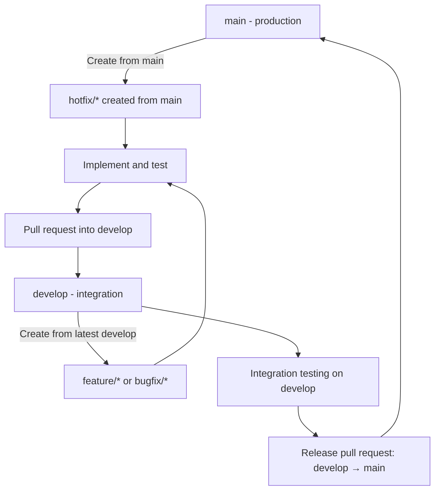

# Exoverse Git Branching Strategy

This document is the source of truth for how Exoverse uses Git branches and pull requests.

`main` is production. `develop` is the integration branch and the only branch that may open a pull request into `main`. Normal work and production hotfixes both land on `develop` first.

## 1. Branch overview

| Branch | Purpose | Created from | Pull request target | Direct commits |
|---|---|---|---|---|
| `main` | Protected production branch. Contains approved releases. | — | — | No |
| `develop` | Integration branch. Completed work is combined and tested here before a release. | `main` at repository setup, then updated by merges | `main` | Avoid; use a pull request |
| `feature/*` | One new feature or task. | Latest `develop` | `develop` | Yes, on the feature branch |
| `bugfix/*` | A non-urgent fix for the next development release. | Latest `develop` | `develop` | Yes, on the bug-fix branch |
| `hotfix/*` | An urgent fix for a production issue. | `main` | `develop` | Yes, on the hotfix branch |

The prefix is case-sensitive and must be followed by a slash and a name. `feature/homepage` matches. `feature`, `Feature/homepage`, and `release/1.0` do not.

## 2. Feature and bug-fix workflow

1. Switch to `develop`.
2. Pull the latest changes from `origin/develop`.
3. Create a `feature/*` or `bugfix/*` branch from that `develop`.
4. Implement the change and test it.
5. Commit on that branch.
6. Push the branch to GitHub.
7. Open a pull request with `develop` as the base branch.
8. Review and test the pull request.
9. Merge it into `develop`.
10. Delete the branch after it merges.

## 3. Releases

A release is a pull request from `develop` to `main`. That is the only pull request the branch policy allows into `main`.

`feature/*`, `bugfix/*`, and `hotfix/*` cannot target `main`.

## 4. Hotfixes

A hotfix starts from production code, then uses the same gate as every other change.

1. Switch to `main` and pull `origin/main`.
2. Create a `hotfix/*` branch from `main`.
3. Fix the production issue and test it.
4. Open a pull request into `develop`. This is allowed.
5. Do not open the hotfix pull request against `main`. The branch policy rejects `hotfix/*` → `main`.
6. After the hotfix is merged and integration-tested on `develop`, release it with a pull request from `develop` to `main`.

`develop` is the exclusive gateway into `main`, including production hotfixes. A `develop` → `main` pull request ships the current state of `develop`, so finish the release review with that in mind.

Hotfix branches stay separate from normal work. A `hotfix/*` name is not treated as a `feature/*` or `bugfix/*` branch.

## 5. Pull request rules

GitHub Actions enforces this table in `.github/workflows/branch-policy.yml` for pull requests that target `develop` or `main`.

| Source | Target | Result |
|---|---|---|
| `feature/*` | `develop` | Pass |
| `bugfix/*` | `develop` | Pass |
| `hotfix/*` | `develop` | Pass |
| `develop` | `main` | Pass |
| `feature/*` | `main` | Fail |
| `bugfix/*` | `main` | Fail |
| `hotfix/*` | `main` | Fail |
| Any other source | `develop` or `main` | Fail |

The workflow reads the pull request source and target from the event. It uses an empty permission set and does not check out the repository.

The check can see the pull request's source and target branch names. It cannot see which branch a feature, bug-fix, or hotfix was created from after that branch exists. Create `feature/*` and `bugfix/*` from the latest `develop`, and create `hotfix/*` from `main`, even though the workflow does not try to reconstruct that parent.

The job also runs a fixed set of pass and fail cases before it judges the open pull request. A failing case names the source, the target, and the path the policy expects.
